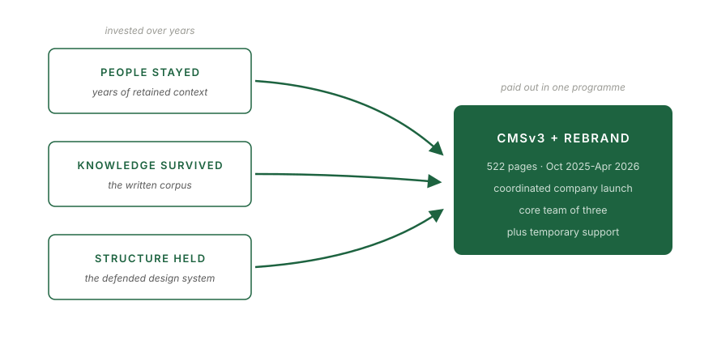
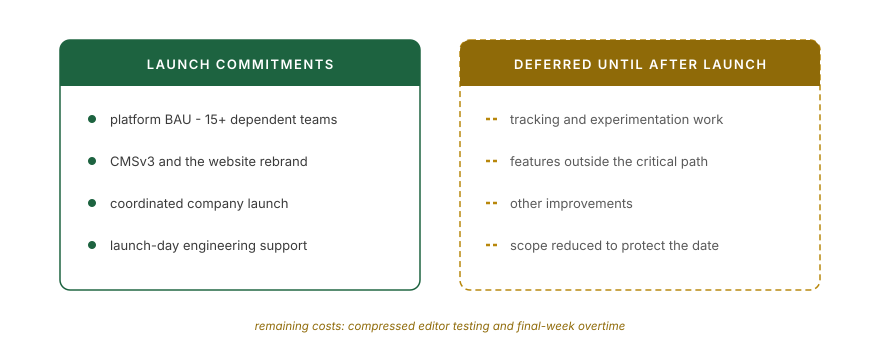

*An expanded account of the programme described in [Shipping the Critical Path With a Nuclear Team](/leadership/2026/09/18/shipping-the-critical-path-with-a-nuclear-team.html), published in September. Here I revisit the technical decisions, the content editors' experience, and the delivery costs that the earlier account did not fully explain.*

From mid-October 2025 to 18 April 2026, my team had to deliver the main website's part of a company-wide rebrand. The date was fixed: the company would announce the brand at a Saturday launch event, and the website needed to change with it. Our core was two engineers and me, with an additional engineer brought in temporarily during the programme.

The 522 pages describe the estate, but they don't describe the work. We were also moving from CMSv2 to CMSv3: reworking architecture, updating dependencies, developing shared components, changing Contentful models, and migrating content into a different frontend application. Both applications used React, TypeScript, and GraphQL connected to Contentful.

The September article focused on the accumulated knowledge that helped this small team deliver. It also described the programme's costs as being paid in scope. That needs a fuller accounting: scope was deferred, but editors still had less testing time than they wanted, and the team worked overtime in the final week. Those facts belong in the same account as the successful launch.

## Why CMSv3 existed

CMSv2 was the result of our earlier migration from Apostrophe to Contentful. During that first move, we had recreated many existing components without enough time to challenge their design. We carried forward technical debt and choices that made the CMS harder for editors to use. Organisational priorities subsequently limited the attention we could give it.

The rebrand gave us a reason to revisit those choices. We wanted more useful, targeted components, a smaller component set, and less cognitive load for content editors. Updating the platform mattered because it supported that work. The goal was a better tool for the people publishing content as well as a new brand for the people reading it.

That connection to users shaped the programme. Our three marketing teams used the CMS with different levels of frequency. We gathered feedback from active editors, reviewed changes with them, and acted on what they told us.

## Where the team's knowledge helped

The engineers knew the estate and proposed solutions we could examine together. Years of [retained context](/leadership/2026/07/31/what-100-percent-retention-actually-looks-like.html), [written documentation](/leadership/2026/08/21/archeology-inheriting-a-system-nobody-documented.html), and [investment in design systems](/leadership/2026/09/11/the-diagram-that-saved-a-capability.html) gave us a foundation for the work.

<figure>
  
  <figcaption>The programme drew on years of investment in people, knowledge, and shared capability.</figcaption>
</figure>

My role included planning, reviewing architectural decisions, removing blockers, and keeping stakeholders informed. I also implemented several redesigned components with AI assistance. Technical involvement was already part of my management practice through PR reviews and direction-setting; the programme added direct component work alongside those responsibilities.

The engineers owned their proposals. They explored options, including with AI assistance, and we tested them before adopting them. I challenged an export-and-reimport migration approach that we did not need, questioned the proposed testing approach, and asked how the new assets would be served and cached. I also challenged features that did not belong on the critical path. There were few major disagreements. Working with a mature team often means checking assumptions and supporting a good solution rather than supplying every answer yourself.

## Preparing a quick switch

The launch needed to look like one quick switch. Making that possible required preparation across the applications, Contentful, and Kubernetes.

We created new fields and content models, then migrated content gradually using scripts and separate environments. Both applications remained available. Cookie-based preview access let us review the new brand on the website before the public launch. We checked asset paths and caching as well as the pages themselves.

Some validation was programmatic, Sentry provided part of our observability, and content editors helped review the result. This was a collaborative effort across engineering and the people who knew the content.

The cutover involved selecting the right content environment and application, with Kubernetes handling traffic redirection. We documented a backup and reversal procedure: the previous application and content environment still existed, so traffic could be directed back to them. But the operational intention was to fix forward once the brand had been publicly announced. Having a technical route back was different from expecting to use it during a coordinated company launch.

We were available on the Saturday to support the switch and address issues. There was some support work on the day; overall, the launch went smoothly.

## Making the capacity decision visible

I raised delivery risks in October. By February, the risks to editor testing time and the team's working hours were clear, and I raised those with my manager too. He helped secure the additional engineer after I made the website's dependency in the company-wide launch explicit.

We also reduced scope. Tracking and experimentation work moved beyond the launch, and I pushed back on features outside the critical path. Alongside that, I worked with the Acquisition team to hand over presentation functionality that belonged to their user journey but lived in our system. Coordination included deciding who should own work after the programme.

<figure>
  
  <figcaption>Scope changes reduced the pressure. They did not eliminate the capacity shortfall.</figcaption>
</figure>

Early escalation and additional support helped, but they did not resolve every constraint. We opened changes for editor testing as early as we could while development continued. The editors' complaint was that they did not have enough time. The team still worked overtime in the final week, even with the extra engineer.

That is the limit of the account: I can explain what I raised, what changed, and what remained difficult. I cannot claim that a different message would certainly have produced more capacity. Nor does meeting the date make the compressed testing window or overtime disappear.

## What changed for editors

We reduced the number of components and acted on editor feedback. After launch, we observed fewer support requests in our Slack channel. Feedback from active editors was positive, alongside the concern about testing time. We also benchmarked performance before and after and presented the results internally.

The support requests are an observation, not a quantified reduction I can substantiate here. They nevertheless give us a useful signal to examine alongside editor feedback. Shipping the platform was one outcome; understanding whether it made their work easier was another.

## What I take from it

The programme brought together technical review, direct implementation, user experience, scope decisions, and stakeholder work. My involvement changed with the problem: questioning an architectural assumption, helping remove a blocker, writing a component, or making a capacity need visible beyond the team.

Since September, I've been studying on the Oxford Emerging Leaders Programme at Saïd Business School. Its work on stakeholder influence and coalitions has given me another way to examine this programme. The development opportunity I take from it is coalition building. I used my reporting line and received support. I could also have worked more deliberately with the teams dependent on the website to build a shared case for capacity and validation time. That might have strengthened the argument in rooms I was not in; it would not have guaranteed a different decision.

The team delivered a substantial platform change and a coordinated launch. The context we had built helped us do it, and the final week showed the limits of that advantage. Both are lessons worth carrying into the next programme.

---

*This is part of an occasional series on engineering leadership under real-world pressure. Earlier posts: [What 100% Team Retention Through Three Restructurings Actually Looks Like](/leadership/2026/07/31/what-100-percent-retention-actually-looks-like.html), [Archaeology: How to Inherit a System Nobody Documented](/leadership/2026/08/21/archeology-inheriting-a-system-nobody-documented.html), [Ten Vendors, One Contract](/leadership/2026/08/24/ten-vendors-one-contract-vendor-evaluation-as-engineering-leadership.html), [Soft Platforms: Why Horizontal Work Dies Inside Product Verticals](/leadership/2026/08/28/soft-platforms-why-horizontal-work-dies-inside-product-verticals.html), and [The Diagram That Saved a Capability](/leadership/2026/09/11/the-diagram-that-saved-a-capability.html). Find me on [LinkedIn](https://www.linkedin.com/in/nvasileiadis).*
